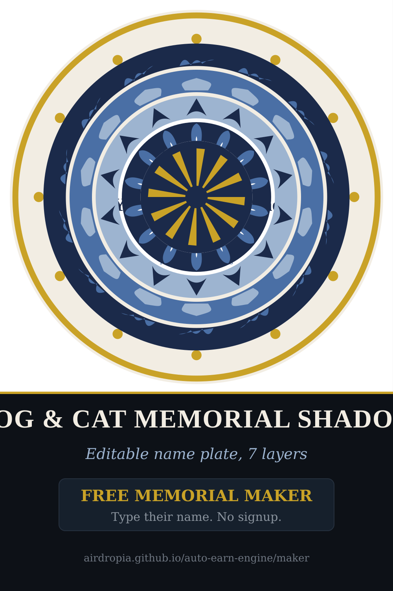

# VectorForge Daily

**Free memorial shadow box maker** — type a pet's or someone's name, pick a
motif, and see the keepsake instantly in your browser. No signup, nothing to
install, nothing uploaded. The name goes into the URL *fragment*, so it is
never sent to a server and never indexed.

**Try it (free, no account):** https://airdropia.github.io/auto-earn-engine/maker/



The same generator that draws the free preview also produces the paid
cut-file bundles: **7-layer shadow-box SVGs** with an **editable name
plate** (you type the name in Cricut Design Space before cutting), plus a
6500px print-ready PNG render.

**Storefront (buy with USDT, no account):**
https://airdropia.github.io/auto-earn-engine/

---

## Why this exists

A shadow box is not bought from a file listing. It is bought from a picture
of the one you lost. So the first thing this project does is give the design
away for nothing: type the name, see it, download a preview. The money is on
the version you can actually cut — separated into seven physical layers with
the name still editable.

## 30-second quickstart

Standard library only. No pip install, no Node, no Docker.

```bash
git clone https://github.com/airdropia/auto-earn-engine
cd auto-earn-engine

python3 pipeline/memorial_generator.py --all   # 9 memorial designs, 7 layers each
python3 pipeline/build_site.py                  # renders the full static storefront
python3 -m http.server 8000                    # open http://localhost:8000
```

Everything renders to `site/` — a self-contained static folder you can host
anywhere (GitHub Pages, Netlify, a USB stick for a client).

## What you get per design

- the combined SVG
- one SVG per layer, named in cut order
- a 6500px print-ready PNG render (vector-lossless, no quality loss)
- a name-plate layer you can edit in Cricut Design Space before cutting

Formats open in Cricut Design Space, Silhouette Studio, Inkscape, Illustrator
and most laser software. All shapes are real vector paths — nothing traced.

## The designs

| Motif | For | Palette |
|---|---|---|
| Paw print | a pet | midnight blue, pearl, antique gold |
| Angel wings | someone you lost | midnight, pearl, gold |
| Rainbow bridge | a pet | midnight, pearl, gold |
| Heart | a pet | plum and gold |
| Leaf | a pet | forest green, gold |
| Waves | a pet | ocean blue, gold |
| Candle | someone you lost | amber, plum, gold |
| Star | a person | night blue, gold |
| Cross | a person | charcoal, slate, gold |

## The pipeline (open source, MIT)

Everything in `pipeline/` is standard-library Python — no third-party
packages, so it runs anywhere Python 3 does.

- `memorial_generator.py` — the nine memorial designs, 7 layers each, with
  the editable name plate. Deterministic: one listing per design, refreshed
  in place.
- `memorial_bundle.py` — packages every memorial design into one bundle
  (one download, every name plate).
- `flagship_generator.py` — a new 7-layer mandala per UTC day (idempotent:
  the slug derives from the date, existing days are skipped).
- `maker.py` — renders the free browser maker: nine motifs, nine colourways,
  SVG/PNG export, and share links that carry the design in the fragment.
- `svgkit.py` — dependency-free SVG geometry helpers used by every design.
- `quality_gate.py` — floor checks (layer counts, palette, path sanity, and
  a rule that a grief design never carries a seasonal tag).
- `checkout.py` / `delivery.py` — zero-signup USDT checkout and automatic
  on-chain payment confirmation. No gateway account, no KYC, no API key.
- `build_site.py` — renders the storefront: product pages, collection
  pages, a blog, JSON-LD, a sitemap, and this maker.
- `indexnow_submit.py`, `serp_probe.py` — tell search engines what changed,
  and record whether they crawled it.

## Licensing

The **code** is MIT (see `LICENSE`). The **generated designs** are free for
personal and commercial use — physical products, client work, printed goods.
Please do not resell or redistribute the raw digital files as-is.

## Links

- Free maker: https://airdropia.github.io/auto-earn-engine/maker/
- Storefront: https://airdropia.github.io/auto-earn-engine/
- Guides: https://airdropia.github.io/auto-earn-engine/blog/
